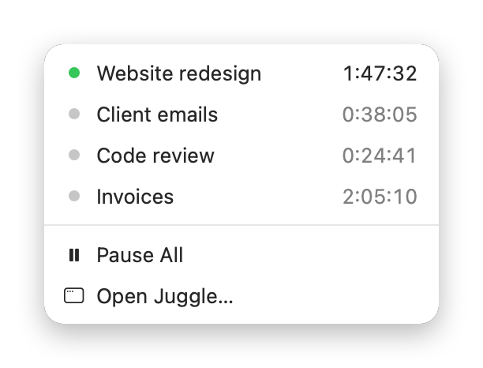
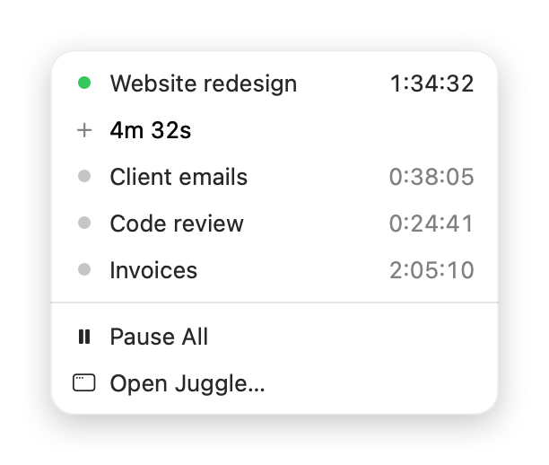
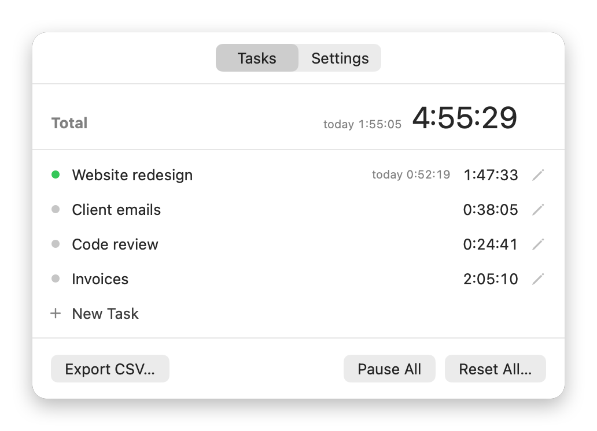
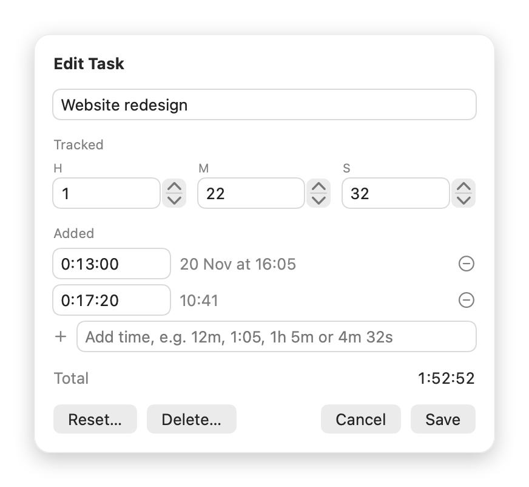

# Juggle

A small macOS menu bar timer for switching between tasks. One task runs at a time, and time a task spends working in the background can be added the moment you switch back to it.

## Switch tasks

Click a task to start it and pause the others, or give each task a keyboard shortcut.

## Add background time

Some work keeps going after you switch away: a build, a test run, an AI agent. When you switch to a task, Juggle offers a field for that time. Type `12` (minutes), `1:05`, `1h 5m` or `4m 32s`, or paste a line such as "Worked for 4m 32s", then press Return. If there's nothing to add, the field closes by itself after 10 seconds.

## See where the time went

The Juggle window shows each task's time today and in total. A task's details keep tracked time apart from time you added, so any addition can be changed or removed later.

## Also

- Export your daily history as CSV, including added time
- Pauses when your Mac sleeps or the screen locks
- Optionally follows Hubstaff: pauses when it stops, continues when it starts

Your data stays on your Mac.

## Run it

Requires macOS 14 or later and Xcode.

1. Open `Juggle.xcodeproj`
2. Press ⌘R

## License

[MIT](LICENSE)
