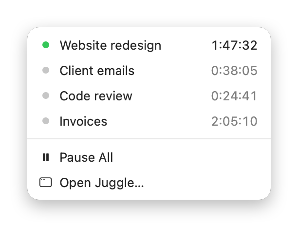
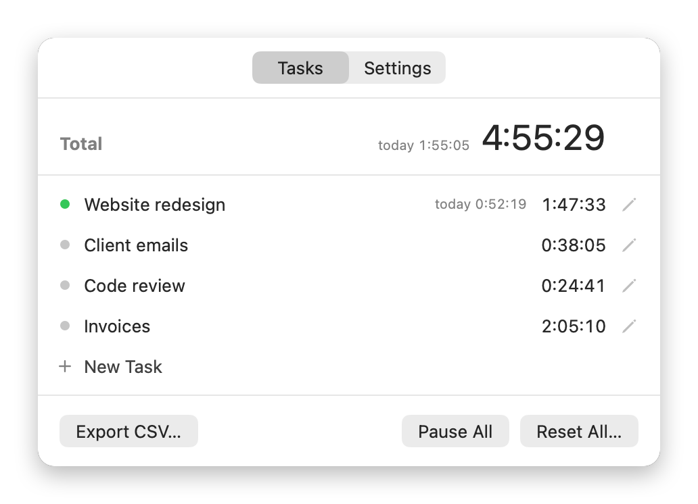

# Juggle

A small macOS menu bar timer for switching between tasks. One task runs at a time.

## Features

- Click a task to start it and pause the others
- Add as many tasks as you need
- See time per task, today and in total
- Export your daily history as CSV
- Optionally follows Hubstaff: pauses when it stops, continues when it starts

Your data stays on your Mac.

## Run it

Requires macOS 14 or later and Xcode.

1. Open `Juggle.xcodeproj`
2. Press ⌘R

## License

[MIT](LICENSE)
